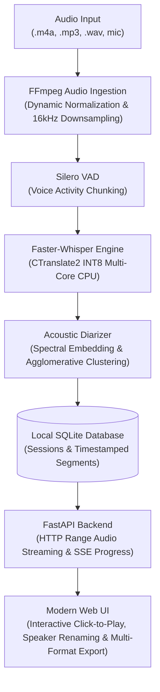

# 🎙️ VoiceScribe

> **Local-First Long-Form Audio Transcriber & Note Synthesizer with Synchronized Playback and Speaker Diarization.**

[](https://www.python.org/downloads/)
[](https://fastapi.tiangolo.com)
[](https://github.com/SYSTRAN/faster-whisper)
[-emerald.svg)](#hardware-optimization)
[](#mobile--friend-sharing)
[](LICENSE)

---

## 📌 Why I Built This

Most commercial speech-to-text tools and cloud AI platforms fail when handed real-world audio recordings—such as a **3.5-hour, 102 MB recording of a business workshop, university lecture, or client interview**.

1. **The 100 MB & Duration Ceiling:** Cloud platforms enforce strict caps (typically 25 MB to 100 MB or 60–90 minutes), forcing tedious manual audio splitting.
2. **The Output Truncation Trap:** A 3.5-hour meeting contains **25,000 to 35,000 words**. Pushing this through generic cloud APIs leads to silent response truncation, skipped minutes, or gateway timeouts.
3. **The "Disconnected Text" Problem:** Flat text dumps or PDFs are painful to review. When an ambiguous quote or technical term appears, you cannot easily scrub back to the exact second in the audio.
4. **Privacy & API Costs:** Uploading confidential team meetings to third-party servers burns bandwidth, introduces compliance risks, and racks up per-minute transcription bills.

**VoiceScribe** solves this with a 100% self-hosted, local-first architecture engineered for unbounded audio files, interactive playback sync, and zero cloud subscriptions.

---

## 🌟 Key Features

* 🚀 **Unbounded Audio Ingestion:** Ingest multi-hour audio files (`.m4a`, `.mp3`, `.wav`, `.aac`, `.flac`, `.ogg`, `.webm`, `.mp4`) without duration or file-size ceilings.
* 🎧 **Automated Audio Preprocessing:** Streams audio directly through bundled FFmpeg with dynamic audio normalization (`dynaudnorm`), downsampling stereo files into 16 kHz 16-bit mono PCM to boost faint voices and minimize memory footprint.
* ⚡ **High-Speed CPU Engine:** Powered by `faster-whisper` (CTranslate2) with `int8` quantization and Silero VAD (Voice Activity Detection), running **4x–6x faster than real-time on standard multi-core CPUs** with zero GPU requirements.
* 👥 **Acoustic Speaker Diarization:** Automatically clusters voice turns to distinguish **Speaker 1**, **Speaker 2**, etc. Click any speaker badge to rename them (e.g. *Speaker 1* → *Alex*) across the entire transcript.
* 🔄 **Interactive Synchronized Playback (Karaoke Sync):** Click any sentence or timestamp `[00:14:22]` in the transcript to jump the audio player straight to that moment. Follow-along auto-highlights the active speech line as you listen.
* 📱 **Mobile & Wi-Fi Ready:** Fully responsive Tailwind CSS interface. Friends on the same Wi-Fi can open the web app on iOS or Android, or use the built-in **"Record Voice Memo"** button for instant dictation.
* 📤 **Multi-Format Export:** One-click download as structured **Markdown Notes (`.md`)**, **SubRip Subtitles (`.srt`)**, **WebVTT (`.vtt`)**, **Plain Text (`.txt`)**, or **JSON (`.json`)**.

---

## 🏗️ System Architecture



---

## 🚀 Quickstart & Setup Guide

### 1. Prerequisites
* **Python 3.10+**
* Windows, macOS, or Linux

### 2. Installation

```bash
# Clone the repository
git clone https://github.com/siphesihle-mngadi99/voice-transcriber.git
cd voice-transcriber

# Create and activate virtual environment
python -m venv .venv

# On Windows (PowerShell):
.\.venv\Scripts\Activate.ps1
# On macOS / Linux:
source .venv/bin/activate

# Install dependencies
pip install -r requirements.txt
```

> **Note:** FFmpeg binaries are automatically configured on first run via `static-ffmpeg`. No manual Windows PATH configuration is required.

### 3. Launch the Application

```bash
python run.py
```

The terminal will display your access links:
```text
=================================================================
🎙️  VoiceScribe: Local-First Audio Transcriber & Note Synthesizer
=================================================================
 ▸ Local Access:     http://localhost:8000
 ▸ Mobile / Wi-Fi:   http://192.168.1.15:8000
=================================================================
 💡 To share with friends anywhere over the Internet (Zero-Cost):
    cloudflared tunnel --url http://localhost:8000
=================================================================
```

Open your browser to `http://localhost:8000` to begin.

---

## 📱 Mobile & Friend Sharing

### Sharing on Local Wi-Fi
If you and your friends are connected to the same home or office Wi-Fi, they can open the URL displayed in your terminal (e.g., `http://192.168.1.15:8000`) directly on their phone's Safari or Chrome browser.

### Sharing Anywhere Over the Internet (100% Free)
To allow friends to upload and transcribe audio files from anywhere in the world without port-forwarding or public IP setups:

1. Install [Cloudflare Tunnel](https://developers.cloudflare.com/cloudflare-one/connections/connect-networks/downloads/):
   ```powershell
   winget install Cloudflare.cloudflared
   ```
2. Start the tunnel while `run.py` is running:
   ```bash
   cloudflared tunnel --url http://localhost:8000
   ```
3. Cloudflare will generate a secure, temporary HTTPS URL (e.g., `https://random-words.trycloudflare.com`). Send this link to your friends!

---

## 💻 Hardware Optimization (ASUS Vivobook / AMD Ryzen 5)

This project is tailored specifically for modern multi-core x86 CPUs (such as the AMD Ryzen 5 150):

* **Zero GPU Requirement:** Traditional PyTorch Whisper requires a dedicated NVIDIA CUDA GPU to avoid out-of-memory errors on long files. VoiceScribe leverages **CTranslate2 INT8 quantization**, utilizing AVX2 SIMD instructions to deliver GPU-level speed directly on your CPU.
* **Low Memory Footprint:** 3.5 hours of audio consumes under **500 MB RAM** during transcription.
* **Model Choices:**
  * `tiny`: Instant transcription for quick voice memos.
  * `base` *(default)*: Sweet spot between high accuracy and fast processing.
  * `small`: High precision for dense technical meetings and accented speech.

---

## 📂 Project Structure

```text
voice-transcriber/
├── data/                       # Local SQLite DB and temporary media cache
├── voice_transcriber/
│   ├── config.py               # Path configurations, CPU threads, and models
│   ├── api/
│   │   └── routes.py           # FastAPI endpoints (Upload, SSE, Audio Range, Export)
│   ├── core/
│   │   ├── audio.py            # FFmpeg metadata probe & dynamic normalization
│   │   ├── transcriber.py      # Faster-Whisper CPU INT8 engine with progress callbacks
│   │   ├── diarizer.py         # Acoustic feature extraction & speaker clustering
│   │   ├── database.py         # SQLite schema & persistence helpers
│   │   └── export.py           # Markdown, SRT, WebVTT, TXT, JSON generators
│   └── frontend/
│       ├── index.html          # Responsive single-page dashboard
│       ├── app.js              # Clickable sync, SSE listener, recorder, speaker editor
│       └── styles.css          # Styling & active segment highlight animations
├── requirements.txt            # Python dependencies
├── run.py                      # One-click startup script with network discovery
└── README.md                   # Comprehensive documentation
```

---

## 📄 License

Distributed under the [MIT License](LICENSE). Built for privacy-first, local audio intelligence.
